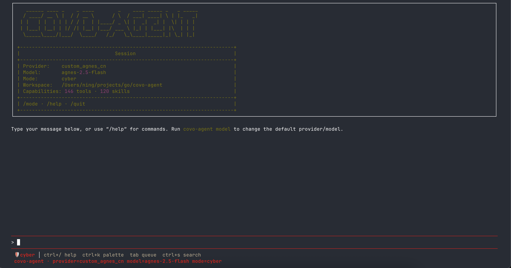

# covo-agent

<p align="center">
  
</p>

[简体中文](README.zh-CN.md) | English

`covo-agent` is a general-purpose AI agent for the terminal, with general, code, and cyber modes. It supports everyday knowledge work, software development, recon/verification, automation, persistent context, and external-system collaboration through an interactive TUI, tools, memory, skills, safety controls, and extensible integrations.



## Highlights

- **Interactive terminal workflow**: streaming responses, tool activity, mouse selection, session history, model picker, themes, and shell completion.
- **Multiple execution modes**: interactive TUI, `-p/--print` for one-shot output, and `exec` for policy-controlled non-interactive runs.
- **Coding tools**: file search and editing, patch application, shell execution, code analysis, review, test generation, Git worktrees, and checkpoints.
- **Cyber mode**: autonomous recon, verification, and exploitation. The parent sets `scan_profile.allowed_hosts` to operator-authorized hostnames before active host/URL `scan` recipes run (`list`, nmap, subfinder, rustscan, ffuf, katana, nuclei, hydra, metasploit, msfvenom, responder, impacket, netexec, fscan, bloodhound, hashcat, john, pwntools, …). Known secondary targets are checked and arbitrary network `extra` flags are refused. Local native scanner launches respect active OS sandbox child-network denial; default/workspace profiles do not enforce destination allowlists at the OS level. Findings, assets, coverage, and HTTP replay evidence are recorded in the engagement ledger.
- **Limited native web checks**: if local `curl` is missing, its `scan` recipe can perform one scoped Go HTTP GET with no extra flags. `web_param_probe` sends one inert marker through an existing query parameter of a recorded GET request. Both produce evidence, not a vulnerability verdict or a replacement for full template and browser scanners.
- **Web evidence workflow**: `web_context` summarizes a recorded endpoint without raw headers or bodies. `csrf_retest` fetches a fresh token from a recorded GET and submits one same-origin form POST; it requires authorized host scope and approval for the POST, and never returns or stores the refreshed token. A successful submission is not a CSRF finding without a negative control.
- **Persistent context**: sessions, memory providers, skills, goals, snapshots, commitments, profiles, and project-level configuration.
- **Provider flexibility**: OpenAI, Anthropic, Gemini, Xiaomi, OpenRouter, and OpenAI-compatible custom providers.
- **Safety controls**: approval gates, allow/deny policies, secret redaction, URL/path checks, OS sandbox profiles, audit logs, and doom-loop recovery.
- **Extensible integrations**: MCP servers, ACP, LSP, plugins, extensions, communication gateways, and custom providers.

## Requirements

- Go **1.25.0** or newer for source builds.
- An API key or login for at least one supported model provider.
- Git is recommended for checkpoints, worktrees, review, and repository-aware features.
- Chrome or Chromium is optional and enables the full browser tool experience.

Feature availability can vary across macOS, Linux, and Windows. Run `covo-agent doctor` to inspect the current environment.

## Install

Install the latest release with a single command:

```bash
curl -fsSL https://raw.githubusercontent.com/covoyage/covo-agent/main/install.sh | bash
```

The script downloads the binary for your OS and architecture from the GitHub Releases page, installs it to `~/.covo-agent/bin`, and adds it to your `PATH`. Pass `--version <version>` to install a specific release, or `--no-modify-path` to skip the shell-config edit.

Install with Homebrew on macOS or Linux:

```bash
brew install --cask covoyage/tap/covo-agent
```

Install with Scoop on Windows:

```powershell
scoop bucket add covoyage https://github.com/covoyage/scoop-bucket
scoop install covoyage/covo-agent
```

Release archives and checksums are also published on the GitHub Releases page.

Install the latest version with Go:

```bash
go install github.com/covoyage/covo-agent/cmd/covo-agent@latest
```

The binary is installed to `GOBIN`, or to `$(go env GOPATH)/bin` when `GOBIN` is not set. Make sure that directory is on your `PATH`.

> Note: `go.mod` references the local `covoyage/covonaut` module via a `replace` directive, so `go install ...@latest` and source builds both require that module to exist locally (see [Build From Source](#build-from-source)).

### Build From Source

Source builds use the dependency layout declared in `go.mod`: the sibling `covoyage/covonaut` repository must be cloned next to `covo-agent` (e.g. `~/projects/go/covonaut`). Prepare the referenced local modules, then clone and build the project:

```bash
mkdir covoyage && cd covoyage
git clone https://github.com/covoyage/covo-agent.git
cd covo-agent

go build -o bin/covo-agent ./cmd/covo-agent
```

Optionally install the binary on your `PATH`:

```bash
install -m 0755 bin/covo-agent "$HOME/.local/bin/covo-agent"
```

## Quick Start

Configure a provider and model:

```bash
covo-agent setup
# or reopen the model/provider picker later
covo-agent model
```

Credentials can also be managed explicitly:

```bash
covo-agent auth add OPENAI_API_KEY=your-key
covo-agent auth list
```

`covo-agent auth login github` uses the GitHub OAuth device flow. For `openai`, `anthropic`, and `gemini`, login opens the provider's API key page in your browser and stores the key you paste into the terminal (it is not an OAuth flow).

Start the interactive TUI in a project directory:

```bash
cd your-project
covo-agent
covo-agent "Find a failing test, fix it, and run the relevant tests."
covo-agent --continue
covo-agent --session
covo-agent init .
```

Run a single prompt without the TUI:

```bash
covo-agent -p "summarize the current repository"
covo-agent --print "review the uncommitted changes" --json
```

Run a constrained headless task:

```bash
covo-agent exec "find the cause of the failing tests" \
  --tools read,grep,glob,bash \
  --allow 'bash:go test *' \
  --deny 'bash:rm *' \
  --permission smart \
  --add-dir ../shared-lib \
  --output-format streaming-json
```

## Execution Modes

| Mode | Example | Use case |
| --- | --- | --- |
| Interactive TUI | `covo-agent` or `covo-agent "prompt"` | Iterative coding, tools, approvals, and session navigation |
| Resume | `covo-agent --continue` | Continue the latest session in this directory |
| Init | `covo-agent init .` | Create `AGENTS.md` project guidance |
| Print | `covo-agent -p "prompt"` | Scripts and a single terminal response |
| Print JSON | `covo-agent -p "prompt" --json` | Structured automation output |
| Exec | `covo-agent exec "prompt"` | Non-interactive agent runs with explicit policies |
| Cyber exec | `covo-agent exec --mode cyber "map hosts on example.com"` | Non-interactive recon run |
| Cyber cron | `covo-agent cron add recon '@daily' 'map hosts'` | Scheduled recon run |
| Exec JSON stream | `covo-agent exec "prompt" --output-format streaming-json` | NDJSON events for text, tools, and errors |
| Structured output | `covo-agent -p "prompt" --output-schema schema.json` | Final answer must match a JSON Schema |

Useful root flags include:

```text
--provider <name>          Override the configured provider
--model <name>             Override the configured model
-c, --continue             Resume the latest session in this directory
--session                  Open the session picker on startup
--mode general|code|cyber  Select the agent mode
--session-id <id>          Resume or create a named session
--sandbox <profile>        workspace, read-only, strict, devbox, off, or custom
--system-prompt <text>     Replace the default system prompt
--output-format            text, json, or streaming-json
--output-schema            JSON Schema for the final answer
--append-system-prompt     Append text to the default system prompt
--permission               TUI: ask|auto|full; exec: smart|full|off
--add-dir <path>           Extra workspace directory (repeatable, max 16)
--yolo                     Bypass approval prompts (high risk)
-p, --print                Run one prompt and print the result (no TUI)
```

Use `covo-agent --help` for the complete and current flag list.

## Command Map

| Area | Commands |
| --- | --- |
| Setup and health | `setup`, `model`, `config`, `auth`, `doctor`, `status`, `version`, `update` |
| Sessions and knowledge | `session`, `memory`, `skill`, `dreaming`, `commitments`, `backup`, `restore`, `migrate` |
| Coding workflow | `analyze`, `review`, `pr`, `testgen`, `worktree` |
| Integrations | `mcp`, `acp`, `lsp`, `gateway`, `pairing`, `plugin`, `ext`, `package` |
| Personalization | `profile`, `language`, `theme`, `features`, `template` |
| Automation | `exec`, `cron`, `heartbeat`, `completion` |

Every command has its own help page:

```bash
covo-agent session --help
covo-agent gateway --help
covo-agent mcp --help
```

Shell completion is available for Bash, Zsh, Fish, and PowerShell:

```bash
covo-agent completion zsh > "${fpath[1]}/_covo-agent"
covo-agent completion bash > ~/.local/share/bash-completion/completions/covo-agent
```

## Configuration

The default global configuration is stored in:

```text
~/.covo-agent/config.yaml
```

A project can override global values with `.covo-agent.yaml`. The loader searches upward from the current directory and stops at the Git root or the user home directory.

Minimal configuration:

```yaml
provider: openai
model: gpt-5.6
mode: code
```

Environment variables in YAML are expanded, so secrets can remain outside the config file:

```yaml
custom_providers:
  - name: Local
    protocol: openai/chat
    base_url: ${CUSTOM_BASE_URL}
    api_key_env: CUSTOM_API_KEY
```

Credentials managed by `covo-agent auth` are stored in `~/.covo-agent/.env` with restrictive file permissions. Project and process environment variables may override configured values.

Profiles use isolated data directories under:

```text
~/.covo-agent/profiles/<profile>/
```

Set `COVO_PROFILE` or use the `profile` command to select one.

Set `COVO_USER_AGENT` to override the `User-Agent` header sent to LLM providers (defaults to `covo-agent/<version>`).

Terminal diffs and code blocks are syntax-highlighted by default: diff-semantic line coloring plus token-level highlighting (language inferred from the file extension), following the active theme. It covers approval diffs, post-edit diff previews, written-content previews, and code fences in assistant messages. Set `COVO_SYNTAX_HIGHLIGHT=false` to disable globally.

## Data Locations

| Path | Purpose |
| --- | --- |
| `~/.covo-agent/config.yaml` | Global configuration |
| `~/.covo-agent/.env` | Provider credentials and environment values |
| `.covo-agent.yaml` | Project-level overrides |
| `~/.covo-agent/sessions/` | Persistent sessions and lifecycle sidecars |
| `~/.covo-agent/skills/` | Installed and user-created skills |
| `~/.covo-agent/covo-agent.log` | Live runtime log; rotated daily to `covo-agent-YYYY-MM-DD.log` (kept 7 days by default) |
| `~/.covo-agent/profiles/` | Isolated profile data |

## Safety

Tool actions that can mutate files, execute commands, or affect external systems pass through approval and policy layers. For automation, use explicit allow and deny rules and a sandbox profile. The `--allow`/`--deny` patterns only apply to `exec` runs; interactive sessions use the approval gate instead.

```bash
covo-agent exec "run the test suite and fix one failure" \
  --sandbox workspace \
  --allow 'edit:*' \
  --allow 'bash:go test *' \
  --deny 'bash:git push*'
```

`--yolo` disables dangerous-operation approval prompts. Use it only in an environment where unrestricted tool execution is acceptable.

## Observability

Telemetry export is opt-in. Point covo-agent at an OTLP HTTP collector (e.g. [Langfuse](https://langfuse.com), Jaeger, Grafana, or any OpenTelemetry collector) with:

```bash
export COVO_OTEL_ENDPOINT=https://cloud.langfuse.com/api/public/otel
# Langfuse uses HTTP Basic auth: base64(publicKey:secretKey)
export COVO_OTEL_HEADERS="Authorization: Basic $(echo -n 'pk-lf-your-public-key:sk-lf-your-secret-key' | base64)"
```

Everything a session does exports as an OTel trace: the session root span carries `session.id` / `langfuse.session.id`, and every LLM call (agent turns, context compression, title generation, reviews, guardrails, auxiliary providers) becomes a model span with GenAI semantic-convention attributes (`gen_ai.request.*`, `gen_ai.prompt`, `gen_ai.completion`, `gen_ai.usage.*`, `gen_ai.response.*`) so backends can compute token usage and cost. Headless, one-shot, review, background-task, and cron invocations are traced and flushed the same way.

### Environment variables

| Variable | Purpose |
| --- | --- |
| `COVO_OTEL_ENDPOINT` | OTLP HTTP endpoint for traces (`/v1/traces` is appended automatically). Also implies `COVO_OTEL_ENABLED=true`. |
| `COVO_OTEL_HEADERS` | Extra HTTP headers, e.g. `Authorization: Basic ...`. Multiple headers separated by `,` or `;`; each key/value split by `:` or `=`, e.g. `Authorization: Basic ..., X-Tenant: acme`. |
| `COVO_OTEL_SERVICE_NAME` | `service.name` resource attribute (default `covo-agent`). |
| `COVO_OTEL_METRICS_ENABLED` | Opt-in OTLP metrics (`true`/`1`). Emits GenAI usage/duration counters, per-call USD cost, error counters (model calls, tool executions, agent runs), and process gauges. |
| `COVO_OTEL_METRICS_ENDPOINT` | Metrics endpoint; defaults to `COVO_OTEL_ENDPOINT`. Langfuse only ingests traces, so target a collector for metrics. |
| `COVO_OTEL_EXPORT_INTERVAL` | Periodic export interval (default `30s`). |
| `COVO_OTEL_ENABLED` | Legacy opt-in flag; setting `COVO_OTEL_ENDPOINT` alone enables export. |

> Note: traces carry raw prompt/completion content, which is what makes token/cost analysis useful. Do not point it at a backend you do not trust with your prompts.

## Claude Code & Codex hooks

covo-agent speaks the [Claude Code hooks protocol](https://docs.anthropic.com/en/docs/claude-code/hooks) and the [OpenAI Codex hooks](https://docs.openai.com/codex/hooks/) configuration format, so hooks you already run in either tool work unchanged:

- `~/.claude/hooks.json` (user-level) and `<project>/.claude/hooks.json` (project-level) are loaded at startup; both the `Hooks` array format and the settings.json-style `hooks` map format are supported.
- `~/.codex/hooks.json` (user-level) and `<project>/.codex/hooks.json` (project-level) are loaded at startup using the Codex `{"hooks": {"Event": [{ "matcher": ..., "hooks": [{ "type": "command", ... }]}]}}` format (only `command` handlers; `timeout`/`timeoutSec` in seconds; matcher `"*"` matches all tools).
- Codex and Claude Code share the same camelCase event names, so hooks from both sources land in the same buckets and can be mixed freely: `PreToolUse`, `PostToolUse`, `UserPromptSubmit`, `Stop` (already honored by the stop gate), and `SessionStart`. `Notification`-style hooks can be registered as `Async`.
- Hooks receive the standard JSON payload on stdin (`hook_event_name`, `session_id`, `cwd`, `tool_name`, `tool_input`, `tool_response`, `prompt`, plus Codex's `model`, `permission_mode` — `plan`/`bypassPermissions`/`acceptEdits` — and `source`) and return a decision on stdout: `approve`/`allow` allows, `deny`/`block` stops the operation (PreToolUse blocks the tool call, UserPromptSubmit aborts the run), and `ask` is treated as fail-open.
- The existing `COVO_ACCEPT_HOOKS` allowlist and per-hook timeout/circuit-breaker protections apply. With the default `COVO_ACCEPT_HOOKS=false`, a hook command runs only after it has been allowlisted (interactive confirmation or `COVO_ACCEPT_HOOKS=true`) — hook registration is skipped until then.
- `.covo-agent-hooks.json`, the Claude Code `.claude/hooks.json`, and the Codex `.codex/hooks.json` files are all hot-reloaded (500ms poll), so policy changes take effect without a restart.

| Variable | Purpose |
| --- | --- |
| `COVO_CLAUDE_HOOKS_DISABLED` | Set `true` to skip loading Claude Code hooks. |
| `COVO_CLAUDE_HOOKS_PATH` | Extra hooks files, colon-separated, loaded after the user/project files. |
| `COVO_CODEX_HOOKS_DISABLED` | Set `true` to skip loading Codex hooks. |
| `COVO_CODEX_HOOKS_PATH` | Extra hooks files, colon-separated, loaded after the user/project files. |

## External agent delegation

covo-agent can delegate standalone, self-contained tasks to external coding agents that run as their own processes via the `external_agent` tool. Supported providers:

- **Claude Code** — driven over its `stream-json` control protocol, the same transport the official [Claude Agent SDK](https://code.claude.com/docs/en/agent-sdk/overview) uses: the provider performs the `initialize` handshake, streams the prompt over stdin, answers `can_use_tool` permission control requests (auto-approving read-only tools, denying everything not explicitly allowed), delivers an `interrupt` on cancellation, and collects the final `result` message. Requires Claude Code `>= 2.0.0` (checked via `claude --version`).
- **OpenAI Codex** — driven over its `app-server` protocol (`codex app-server --stdio`), the same JSON-RPC-over-stdio transport the official [Codex SDKs](https://developers.openai.com/codex/app-server) and the VS Code extension use: the provider performs the `initialize` → `initialized` handshake, creates an `ephemeral` thread, runs one `turn`, answers approval server requests unattended (command/file approvals are declined — or allowed under `permission_mode: bypassPermissions` — permission upgrades and user-input prompts are denied), sends `turn/interrupt` on cancellation, and returns the message with `phase: "final_answer"` (falling back to the latest unphased agent message). Requires Codex `>= 0.136.0` (checked via `codex --version`).
- **opencode** — `opencode run`.

No product SDK is installed; each provider drives the product's own CLI (the same binary those SDKs wrap). The task must be fully self-contained since the external agent cannot see the current conversation. `permission_mode` (`default`/`acceptEdits`/`plan`/`bypassPermissions`) applies to Claude and Codex; `allowed_tools`/`disallowed_tools`/`max_turns` are Claude-specific; `model` applies to Claude and Codex.

Each provider is usable only when its CLI binary is installed, signed in, and on `PATH`. `COVO_EXTERNAL_AGENTS` controls which providers are exposed:

| Value | Effect |
| --- | --- |
| `all` (default) | Register every known provider (Claude Code, Codex, opencode). |
| `claude,codex` | Register only the listed providers (comma-separated). |
| `off` / `none` | Disable delegation; the `external_agent` tool is not exposed. |

## Troubleshooting

Run the environment and configuration checks:

```bash
covo-agent doctor
covo-agent doctor --fix
```

Common checks include:

- home, configuration, credential, session, and skill paths;
- provider key and model configuration;
- Git and browser availability;
- terminal color, clipboard, multiplexer, and keyboard capabilities.

Interactive warnings are written to `~/.covo-agent/covo-agent.log` so they do not corrupt the alternate-screen TUI. The live file rotates at local midnight to `covo-agent-YYYY-MM-DD.log`; dated files older than 7 days are deleted. Set `logging.retain_days` in `config.yaml` or `COVO_LOG_RETAIN_DAYS` to change the window.

## Development

Before building, make sure the local module paths declared in `go.mod` are available in the workspace.

```bash
go build ./...
go test ./...
go vet ./...
```

Build the runnable binary after making changes:

```bash
go build -o bin/covo-agent ./cmd/covo-agent
```

Before submitting changes, run the build, test, and vet commands above and rebuild the executable.

## License

This project is licensed under the [GNU Affero General Public License v3.0](LICENSE) (`AGPL-3.0`).
